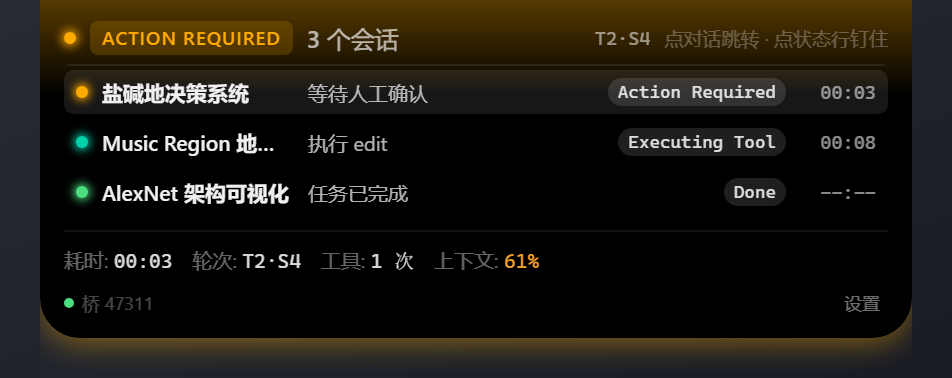
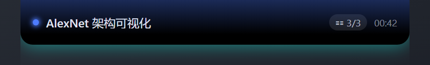
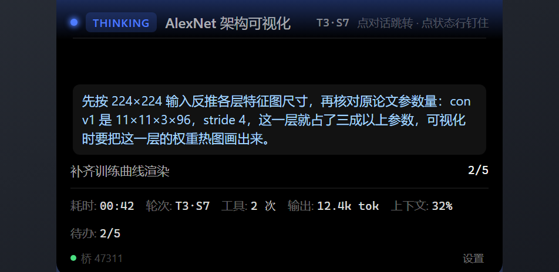
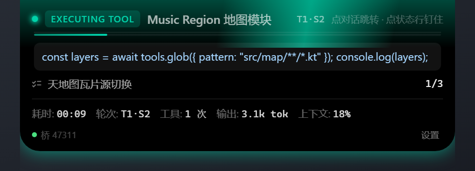

<div align="center">

# 🏝️ DSH DeepIsland

**专为 DeepSeek Harness 设计的双端原生灵动岛状态栏**

实时感知智能体状态 · 深度思维链解析 · 多会话并行监控 · 一键跳转交互

[](https://opensource.org/licenses/MIT)
[](#-平台支持)
[](https://github.com/myYangyunfan/dsh-deepisland/releases)
[](#-开发与测试)

<br>



<p align="center">
  <sub>在 macOS 物理刘海或 Windows 屏幕顶端居中悬浮窗实时显示智能体进度，点击即刻跳转对应会话。</sub>
</p>

</div>

---

## 💡 为什么需要 DeepIsland？

使用 DeepSeek Harness 进行长链路工程任务时，智能体常在后台经历漫长的深度思考与工具调用。切屏确认进度不仅打断心流，更难以及时响应人工审批请求。

**DeepIsland** 将状态感知推向系统级前台：
- **物理刘海融合**：macOS 顶端原生刘海硬件融合；Windows 顶端无边框贴边悬浮（与 macOS 同一套视觉语言：纯黑底 + 状态色内发光带 + 沿剪影外发光）。
- **双路状态仲裁**：优先跑会话多帧 zstd 事件流（`ActivityCursor`），投影启发式兜底；Windows 端实测事件流已含 `tool/call`、`turn/start`、`approval/*` 等完整状态事件。
- **会话一键穿梭**：点击状态栏直接拉起 DSH 并聚焦至对应会话，零权限依赖、免键盘模拟。
- **轻量低开销**：Windows 端快照只传渲染层真会读的 DTO 并按内容指纹（`rev`）去重推送，空闲/隐藏时轮询自适应降到 1s；渲染层热路径零强制同步布局、无全量 `innerHTML` 重建。实测数据见 [`windows/README.md`](./windows/README.md#性能基准scriptsperfjs)。

---

## 📸 状态展示

### 1. 紧凑折叠态（Compact Mode）

屏幕顶端常驻，以色彩与微动效呈现智能体实时动作，不遮挡日常视线：

| 💭 深度思考 | ⚡ 工具执行 | 🔀 多会话并行 |
| :---: | :---: | :---: |
|  |  |  |
| 实时截取思维链要点（蓝光） | 显示当前工具与操作文件（青光） | 显示优先级最高会话 + 数量角标 |

### 2. 悬停展开态（HUD Mode）

鼠标悬停 0.2s 平滑展开，显示耗时、轮次、工具调用数、Token 消耗及多任务列表：

| 单会话深度监控 | 工具调用与耗时 | 多任务并行调度 |
| :---: | :---: | :---: |
|  |  |  |
| 进度条、思考耗时、上下文量 | 实时显示执行命令与参数 | 按优先级排序，点击切换聚焦 |

---

## ⚡ 核心功能

- **深度思考链解析**：从 `assistant/message` 提取 `reasoning` 内容，长思考过程不再显示为空白等待。
- **多会话并发管理**：最多同时追踪 6 个后台任务。状态优先级排序：`等待审批 > 工具执行 > 思考中 > 已完成 > 待命`。
- **阻塞事件主动唤起**：检测到需要人工确认的敏感工具调用时，状态指示切换为琥珀色心跳脉冲并自动展开 HUD。
- **界面与动效**：宽/高/圆角共用一条按 SwiftUI 弹簧解析式采样 61 点的 `linear()` 真弹簧；展开时内容按层阶梯入场；思考呼吸 / 工具流光 / 等待脉冲 / 完成微光，全部受「光效开关」与系统 `prefers-reduced-motion` 双重门控。
- **无感本机跳转**：通过本机回环 HTTP 握手桥与 DSH 内部视图管理器联动，点击即可精准唤起并定位目标会话。
- **自动防误唤醒**：内置回合结束标记识别（`sawTurnEnd`），会话交付后杜绝残存投影引发假性激活。

---

## 🚀 快速安装

### 推荐：DSH 插件管理器一键安装

插件充当控制面与本机通信桥，并负责应用端缺失时的静默自愈安装。

1. 打开 **DSH Desktop** → **插件管理**。
2. 输入完整 Git 仓库地址并安装：
   ```text
   git+https://github.com/myYangyunfan/dsh-deepisland.git
   ```
3. 在安装完成弹窗中点击 **「立即启用」**（写入 `dsh.profile.bundles` 配置）。
4. **重启 DSH Desktop**。插件加载后将自动下载校验对应系统的原生应用，数秒后灵动岛即刻呈现。

<details>
<summary><b>🔍 验证安装状态</b></summary>

在终端执行健康检查命令：
```bash
curl -s http://127.0.0.1:47311/health
# 返回 {"ok":true,"keys":[...]} 即表示控制面与跳转桥正常运转
```
</details>

<details>
<summary><b>🛠️ 备用方案：手动编译安装独立应用</b></summary>

无需插件控制面亦可独立运行原生灵动岛（仅失去一键跳转能力）：

**macOS 原生构建：**
```bash
cd swift
./build.sh install
```

**Windows 便携部署：**
从 [Releases](https://github.com/myYangyunfan/dsh-deepisland/releases) 下载最新发行版压缩包，解压至 `%LOCALAPPDATA%\Programs\DSHNotch\` 即可。

详见 [`swift/INSTALL.md`](./swift/INSTALL.md) 与 [`windows/README.md`](./windows/README.md)。
</details>

---

## 🎮 交互指南

| 触发操作 | 响应动作 | 说明 |
| :--- | :--- | :--- |
| **悬停 0.2 秒** | 展开 HUD 面板 | 查看上下文 Token、工具详情及多会话列表 |
| **移出 0.35 秒** | 收起面板 | 平滑淡出，不干扰主屏幕操作 |
| **单击岛体空白处** | 锁定 / 解锁常驻 | 常驻状态下鼠标移开不会自动收拢 |
| **单击会话条目** | 穿梭跳转会话 | 拉起后台 DSH 窗口并切换至该会话上下文 |
| **右键岛体** | 原生菜单 | 钉住/取消、隐藏、打开 DSH 设置、打开配置目录、退出（Windows v2） |
| **HUD 键盘** | `↑/↓` 选行、`Enter` 跳转、`Esc` 取消钉住 | 键盘可达性与焦点环 |
| **托盘 / 菜单栏图标** | 系统级控制菜单 | 快速开关灵动岛、开机启动项、重载配置 |

---

## ⚙️ 配置说明

配置文件位于各系统标准应用数据目录的 `client-config.json` 中：
- **macOS**: `~/Library/Application Support/DSHNotch/client-config.json`
- **Windows**: `%APPDATA%\DSHNotch\client-config.json`

修改后立即生效（应用端自适应轮询配置文件 `mtime`：活跃 250ms / 空闲或隐藏 1s，无需重启）：

| 参数名 | 类型 | 默认值 | 描述 |
| :--- | :---: | :---: | :--- |
| `notchEnabled` | boolean | `true` | 全局开关：是否显示屏幕顶端灵动岛 |
| `jumpEnabled` | boolean | `true` | 是否启用点击一键跳转会话功能 |
| `hideWhenIdle` | boolean | `false` | 智能体进入待命状态后是否完全隐藏岛体 |
| `glowEffect` | boolean | `true` | 思考与工具调用时的边缘流光光晕动效 |
| `expandOnHover` | boolean | `true` | 是否允许鼠标悬停自动展开 HUD 面板 |
| `scale` | number | `1.0` | 界面整体缩放比例（支持范围 0.5 ~ 2.0） |
| `placement` | string | `"notch"` | 放置模式：`"notch"` (顶部吸附) / `"floating"` (悬浮) |
| `platformMode` | string | `"auto"` | 视觉风格：`"auto"` / `"macos"` (黑晶) / `"windows"` (亚克力) |
| `showSubagentCount` | boolean | `true` | 并行子代理运行时是否显示右侧数字角标 |
| `bridgeEnabled` | boolean | `true` | 本机回环通信服务开关（仅影响跨进程跳转） |
| `bridgePort` | number | `47311` | 本机通信端口（冲突时向后顺延并在 `bridge.json` 回写） |
| `autoInstallApp` | boolean | `true` | 缺少原生应用时是否自动拉取匹配版本安装 |

---

## 🏛️ 体系架构

系统解耦为 **插件控制面** 与 **原生呈现宿主**，两者通过回环接口解耦交互：

```
┌────────────────────────────────────────────────────────┐
│                   DSH Desktop Host                     │
│  ┌──────────────────────┐    ┌──────────────────────┐  │
│  │   UI / Workspace     │    │   Session Storage    │  │
│  │ (openSession Hook)   │    │ (*.jsonl.zstd 流追加) │  │
│  └──────────▲───────────┘    └──────────┬───────────┘  │
└─────────────┼───────────────────────────┼──────────────┘
              │ 轮询 /next                 │ 增量多帧解压
┌─────────────┴───────────┐               │
│  插件控制面 (127.0.0.1)  │               │
│  (端口 47311 / IPC 桥)   │               │
└─────────────▲───────────┘               │
              │ POST /jump                ▼
┌─────────────┴──────────────────────────────────────────┐
│             原生状态栏端 (Swift / Electron)             │
│        - ActivityCursor 增量游标 (Multi-frame Zstd)     │
│        - 弹簧物理动效渲染 (Spring Dynamics)             │
└────────────────────────────────────────────────────────┘
```

<details>
<summary><b>🔬 核心技术点解析</b></summary>

1. **多帧级联 Zstandard 流解包**：DSH 采用追加模式写入压缩事件流，由多个独立的 Zstd 帧顺序拼接组成（魔数 `0x28 0xB5 0x2F 0xFD`）。基础单帧解压器仅解析首帧会导致大量后续事件丢失。DeepIsland 实现了帧边界探测与级联重组算法，确保事件流零截断。
2. **状态仲裁双重通道**：以高实时性事件流（`ActivityCursor`）为主通道，在会话读写锁冲突或文件不完整时，自动切换至宿主投影文件（`inferFromProjection`）进行状态补间，并在回合终结时以 `sawTurnEnd` 机制抑制幽灵唤醒。
3. **精准跳转回环握手**：点击事件通过 `POST /jump` 入队，由嵌入在 DSH 渲染上下文中的客户端轮询拾取，调用特权接口 `ctx.uiWorkspace.openSession` 切换视图，同时触发系统级窗口置顶聚焦。

</details>

---

## 💻 平台支持

| 平台 | 实现语言 | 视觉形态 | 系统兼容性 |
| :--- | :--- | :--- | :--- |
| **macOS** | Swift + AppKit (`NSPanel`) | 物理刘海吸附融合 | macOS 13.0 (Ventura) 及以上，原生适配 Apple Silicon / Intel |
| **Windows** | Electron + HTML5 / CSS3 | 顶端无边框悬浮窗（纯黑底 + 状态光，与 macOS 同语言） | Windows 10 / 11 64-bit |

---

## 🧪 开发与测试

本项目高度重视工程稳定性，包含两套无外部测试框架依赖的原生测试集：

```bash
# 1. 运行插件端自动化测试（336 项测试用例全部通过）
node test/run.mjs all

# 2. 运行 Windows 原生端回归测试（507 项测试用例全部通过）
cd windows && npm test

# 3. 运行 macOS 原生端测试套件
cd swift && ./build.sh all-tests

# 4. 驱动真实渲染层生成 2x 高清实机状态截图
cd windows && npm run shots

# 5. Windows 渲染层性能基准（与仓库基线对比；数字必须同机、同显示模式看）
cd windows && npm run perf
```

---

## ❓ 常见问题 (FAQ)

<details>
<summary><b>Q: 插件安装完成后，屏幕顶端没有出现灵动岛？</b></summary>

通常是因为宿主环境尚未加载该插件。DSH Desktop 安装插件后，需确保点击插件卡片上的 **「立即启用」** 将其载入 `dsh.profile.bundles`，随后**彻底重启 DSH Desktop**（必须退出进程重开，仅关闭主窗口无效）。
</details>

<details>
<summary><b>Q: 点击会话条目无法跳转到 DSH 窗口？</b></summary>

1. 确认 DSH 设置中 `jumpEnabled` 为开启状态；
2. 确认控制面端口 `47311` 未被第三方安全软件拦截；
3. Windows 端因系统权限限制，若主窗口处于最小化托盘状态，可配合任务栏切换后使用快捷键定位。
</details>

<details>
<summary><b>Q: 自动下载原生程序时提示网络失败？</b></summary>

插件内置智能代理感知模块，会自动尝试读取系统 `HTTP_PROXY` 与 `HTTPS_PROXY` 环境变量走隧道下载。若网络受限，可根据上方说明手动下载 Release 产物放置于目标目录，插件检测到已有可执行文件会自动跳过下载步骤。
</details>

---

## 📄 开源许可证

本项目基于 [MIT 许可证](./LICENSE) 开源。
Copyright © 2025-2026 Yangyunfan. All rights reserved.
